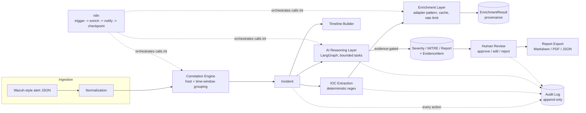
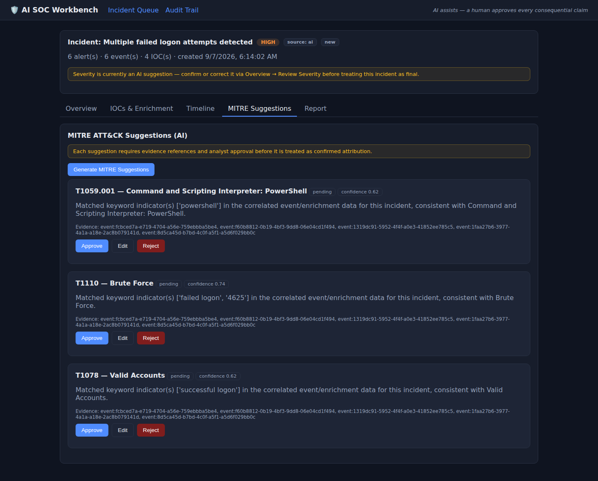

# AI SOC Workbench

> 👋 **New here, or not a developer?** Skip straight to
> **[`START_HERE.md`](START_HERE.md)** — a step-by-step guide with zero
> assumed coding experience to get this running on your own computer.

**Explainable, human-in-the-loop security investigation automation.**

The AI assists; it never autonomously declares an incident malicious, isolates a
system, blocks anything, or deletes evidence. Every AI claim carries evidence
and provenance. A human approves before anything is treated as final.

---

## The problem

SOC analysts repeat the same manual steps on every alert: triage, IOC
extraction, threat-intel enrichment, event correlation, MITRE ATT&CK mapping,
timeline construction, incident-report drafting. This project turns those
repetitive steps into a guided, evidence-backed investigation workflow —
without ever letting a model make the actual security decision.

## Who this is for

- **SOC analysts** who want the repetitive 80% of triage done for them, with
  every AI claim they can click into and see exactly why the system thinks
  what it thinks.
- **SOC leads / CISOs** evaluating whether "AI in the SOC" can be done without
  handing a language model the keys to isolate a host or close a case.
- Readers of this repo as a **portfolio / research artifact** in applied
  digital-forensics and AI-safety engineering — see `INTERVIEW_PREP.md`.

## Core principle (non-negotiable, built into the software, not just policy)

1. The AI never has network, shell, or response-action tool access. There is
   no code path anywhere in this repository that isolates a host, blocks an
   IP, deletes evidence, or closes an incident automatically.
2. Every AI-generated claim (severity, MITRE technique, report section) must
   cite at least one piece of evidence that actually exists. A claim without
   real evidence is dropped **before it reaches the database**, and the drop
   itself is recorded in the audit trail.
3. A human analyst reviews and approves/edits/rejects every AI claim before
   it is treated as final (`POST /incidents/{id}/review`).
4. Everything writes to an append-only audit log: who, what, when, why.
5. All data is synthetic. All threat-intelligence providers are mocked by
   default; going live is one `.env` flag away and still opt-in per provider.

---

## Architecture



Layers (see `backend/app/`):

| Layer | Module | Notes |
|---|---|---|
| Ingestion | `api/routes/alerts.py` | Accepts Wazuh-style alert JSON |
| Normalization | `services/normalization.py` | Deterministic; malformed input degrades safely, never crashes |
| Correlation / grouping | `services/correlation.py` | Host + time-window grouping into incidents; explainable by design (no black-box clustering) |
| IOC extraction | `services/ioc_extraction.py` | Regex-based, TLD-allowlisted, dedicated username/domain heuristics |
| Enrichment | `services/enrichment.py`, `adapters/` | Adapter pattern; mocked VirusTotal/AbuseIPDB by default, cached + rate-limited, real-provider toggle in `.env` |
| AI reasoning | `ai/graph.py`, `ai/context.py`, `ai/guardrails.py` | LangGraph, provider-agnostic, structured Pydantic outputs only, evidence-gated |
| Evidence / provenance | `models/evidence_item.py` | Polymorphic; every AI claim resolves to real evidence or is dropped |
| Human review | `services/review.py` | approve / edit / reject, logged |
| Report generation | `services/export.py` | Markdown / PDF / JSON, always labeled AI-generated |
| REST API | `api/routes/` | FastAPI |
| Dashboard | `frontend/src/` | React + TypeScript |
| Workflow automation | `n8n/` | Orchestration only — see `n8n/README.md` |
| Audit | `services/audit.py`, `models/audit_log.py` | Append-only, single writer |

Full database schema (13 entities: `users`, `alerts`, `incidents`, `events`,
`iocs`, `enrichment_results`, `mitre_suggestions`, `timelines`,
`timeline_events`, `reports`, `evidence_items`, `analyst_reviews`,
`audit_logs`) is defined in `backend/app/models/` and versioned via Alembic
(`backend/alembic/versions/`). See `docs/architecture.md` for the entity
relationship diagram and a deeper walk-through of each layer.

## Tech stack

Python 3.12 / FastAPI / SQLAlchemy / PostgreSQL / Redis-ready caching /
LangGraph / provider-agnostic LLM interface (mock, OpenAI, Anthropic) /
React + TypeScript / Docker Compose / n8n / pytest / Ruff + Black / GitHub
Actions.

## Quickstart

```bash
git clone <this-repo>
cd ai-soc-workbench
cp .env.example .env      # defaults work out of the box, zero paid API keys required
docker-compose up
```

- API: `http://localhost:8000` (interactive docs at `/docs`)
- Dashboard: `http://localhost:5173`
- n8n: `http://localhost:5678`

Full instructions, including running the backend/frontend without Docker, are
in `docs/setup-guide.md`.

## The dashboard



Every AI-facing panel follows the same pattern shown above: a suggestion,
the evidence it's based on, and controls to approve/edit/reject it — never
a suggestion presented as already final. More screenshots (incident queue,
IOC enrichment, timeline, report draft, audit trail) with descriptions are
in `docs/screenshots/`.

## The demo scenario

`data/synthetic/demo_incident_powershell.json` is a complete synthetic
incident: a brute-force login followed by a success, then encoded PowerShell
downloading a payload from a C2 domain, then an outbound connection to that
domain. Walking it through the API (or the dashboard) end to end —
ingest → correlate → extract IOCs → enrich → build timeline → suggest
severity → suggest MITRE techniques → draft report → analyst review →
export — is documented step by step in `docs/demo-walkthrough.md`, with the
actual API responses from a real run.

## Measured results

`scripts/benchmark.py` runs the full pipeline against five hand-labeled
synthetic cases (`data/eval/eval_cases.json`) and writes real, measured
numbers — not projections — to `docs/benchmark_results.md`. Highlights from
the run committed in this repo (re-run it yourself; numbers refresh):

- MITRE ATT&CK suggestion accuracy: mean F1 = 0.80 vs. hand-labeled ground truth
- Incident-classification accuracy: 0.80 (5-case set), with one honestly-reported
  false positive — see the per-case table for why
- 0% hallucination rate among *persisted* AI claims (by construction: every
  claim without a resolvable evidence reference is dropped pre-persistence;
  see the adversarial tests for a stress test of that path)
- API failure rate: 0% across 35 requests in the benchmark run

**What is *not* measured yet, and why**: human correction rate (needs real
analyst usage over time — the instrumentation exists, the number doesn't
yet) and manual-workflow *timing* (no human analysts were available to time
a fully manual investigation; the manual comparison here is a documented
step count, not a stopwatch). Both are called out explicitly, not omitted
silently — see `docs/benchmark_results.md`.

## Testing

```bash
cd backend
pytest -q --cov=app          # 55 tests: unit, API, DB, integration, adversarial, regression
ruff check app tests && black --check app tests
```

The adversarial suite (`tests/adversarial/`) specifically exercises
prompt-injection defenses and a deliberately hallucinating LLM provider to
prove the evidence-drop guardrail actually works, not just that it's
documented. Several of these tests caught and led to fixing real bugs during
development (a non-string `rule_description` crashing incident creation on
malformed input; an empty alert batch triggering a 500) — see commit history.

## Security controls

Full detail in `SECURITY.md`. Summary: no hard-coded secrets, mocked
providers by default, structural prompt-injection defense (untrusted text
never in a system-role prompt), evidence-required guardrails, append-only
audit log, RBAC on the two endpoints where it matters most (review
submission, integration configuration), dependency scanning in CI
(`pip-audit`, `npm audit`) with two remaining findings tracked as accepted,
upstream-blocked risks.

## Limitations (honest, not aspirational)

- **IOC extraction is regex-based**, not ML-based. It's deliberately
  explainable (an analyst can read the pattern that matched) but will miss
  obfuscated or novel indicator formats a trained model might catch.
- **Correlation is host + time-window grouping**, not graph-based or
  ML-clustered. Simple and auditable; will under- or over-group in more
  complex multi-host campaigns.
- **The default LLM "provider" is a deterministic mock**, not a real
  language model — it's rule/keyword-based, built so the whole system runs
  with zero API keys and is fully reproducible for testing/benchmarking. It
  is provider-agnostic by design (`app/ai/providers/`), and swapping in a
  real OpenAI/Anthropic model is a one-line `.env` change plus a key — but
  the benchmark numbers in this repo were produced against the mock, and
  that is stated plainly wherever those numbers appear.
- **Human correction rate is unmeasured** — no live analyst usage has
  occurred against this system yet.
- **`docker-compose up` was validated by running each service's exact build
  and runtime commands natively** (Postgres, the FastAPI app via `alembic
  upgrade head` + `uvicorn`, the React app via `vite build` + a static
  server) in the development environment this was built in, whose network
  policy blocks pulling public Docker Hub base images directly. The
  Dockerfiles and `docker-compose.yml` are thin wrappers around those same
  verified commands; if your environment has normal internet access,
  `docker-compose up` should work as documented, but this specific
  end-to-end path (all five containers, composed together) has not been
  executed to completion in this repo's own development environment.
- One dependency advisory (Starlette, several CVEs) can't be fully resolved
  yet because the fix versions aren't compatible with the current FastAPI
  release — tracked in `SECURITY.md`, not silently ignored.

## Roadmap

See `docs/roadmap.md`.

## Documentation index

- `docs/business-value.md` — how this maps to banking/corporate security requirements, and CV/interview framing
- `docs/architecture.md` — deeper architecture + ER diagram
- `docs/threat-model.md` — STRIDE-style threat model
- `docs/setup-guide.md` — full setup instructions (Docker and non-Docker)
- `docs/demo-walkthrough.md` — the synthetic demo scenario, step by step, with real responses
- `docs/screenshots/` — real dashboard screenshots from a live run, with descriptions
- `docs/benchmark_results.md` — measured evaluation results (auto-generated by `scripts/benchmark.py`)
- `docs/roadmap.md` — what's next
- `SECURITY.md` — security policy and dependency-risk tracking
- `CONTRIBUTING.md` — how to contribute
- `INTERVIEW_PREP.md` — study document for discussing this project in an interview or PhD conversation
- API reference: run the stack and open `http://localhost:8000/docs` (FastAPI's generated OpenAPI UI)

## Explicitly NOT built

Autonomous host isolation, automatic firewall blocking, credential theft,
malware deployment, destructive remediation of any kind, uncontrolled
internet scanning, real customer-data processing, or any claim of
guaranteed detection accuracy. If you find a code path that does any of
these, it's a bug — please report it.

## License

MIT — see `LICENSE`.
